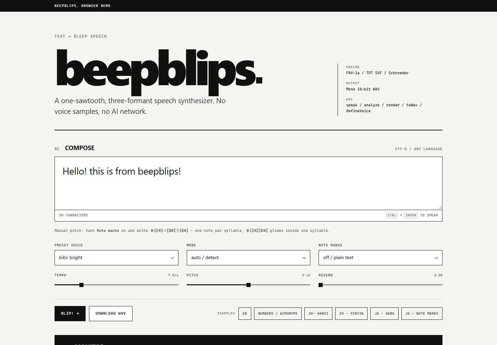

# beepblips.

**单文件“哔哔语”合成器**

[](https://github.com/MonoIAR/beepblips/actions/workflows/ci.yml)
[](https://www.npmjs.com/package/@monoiar/beepblips)
[](../LICENSE)
[](https://monoiar.github.io/beepblips/)

[English README](../README.md)

beepblips 把一句话变成动森、蔚蓝里那种“哔哔啵啵”的说话声。没有录音采样，也没有神经网络：一条锯齿波过三个共振峰滤波器，每个音节发一声，标点决定旋律上扬、下落还是拖长。引擎是约 58 KiB 的纯 JavaScript，不做任何 I/O，同一份文件能跑在 Node、浏览器和自带的演示页里。



## 支持的语言

- **中文 · 拼音**：最接近真人中文，效果最好。
- **中文 · 汉字**：按哈希决定发音。
- **日语 · 假名**：平假名和片假名按モーラ读，元音和节奏都是真的；汉字仍按哈希。
- **英文**：效果还不错。
- 其他语言：按哈希决定发音。

## 安装

### 方式一：直接拷文件

`beepblips.js` 本身就是库。放到项目里直接 import：

```js
import {speak, toWav} from './vendor/beepblips.js';
```

不需要构建步骤、打包插件或额外资源，引擎里没有 `window` / `fs` / `fetch`。

### 方式二：作为 npm 包

```bash
npm install @monoiar/beepblips
```

`package.json` 已经映射了根导出，导入名就是包名：

```js
import {speak} from '@monoiar/beepblips';
```

### 方式三：浏览器里直接引用

```html
<script type="module">
  import {speak, toWav} from './beepblips.js';
</script>
```

用任意静态服务器打开页面即可——浏览器不允许从 `file://` 加载 ES module。自带的演示页在构建时把引擎内联进 HTML，所以双击 `index.html` 也能用。

CLI 和测试需要 Node 22+；引擎本身是普通 ES2020，也能在 Deno、Bun 和 Web Worker 里运行。

## 快速开始

**Node：写一个 WAV 文件**

```js
import {writeFileSync} from 'node:fs';
import {speak, toWav} from './beepblips.js';

const {samples, sampleRate, duration, cues} = speak('Hello! Is this thing on?', {voice: 'bibi'});

writeFileSync('hello.wav', toWav(samples, sampleRate));
console.log(`${duration.toFixed(2)}s, ${cues.length} syllables`);
```

**浏览器：用 Web Audio 播放**

```js
import {speak} from './beepblips.js';

const ctx = new AudioContext();
const {samples, sampleRate} = speak('Hello!', {voice: 'bibi'});

const buffer = ctx.createBuffer(1, samples.length, sampleRate);
buffer.copyToChannel(samples, 0);

const source = ctx.createBufferSource();
source.buffer = buffer;
source.connect(ctx.destination);
source.start();
```

`speak()` 返回单声道 `Float32Array`；需要文件时用 `toWav()` 转成 WAV 字节。

## API 一览

| 导入 | 作用 |
| --- | --- |
| `speak(text, opts?)` | 分析与渲染一次完成：samples、cues、plan |
| `analyze(text, opts?)` | 文本 → `Plan`（无音频，纯 JSON） |
| `render(plan, opts?)` | `Plan` → samples（cues 带绝对音高） |
| `toWav(samples, sampleRate?)` | `Float32Array` → WAV 字节 |
| `defineVoice(overrides, base?)` | 基于预设生成并校验自定义声线 |
| `mouthOf(vowel)` | 元音 → `{open, wide}`，用于口型同步 |
| `hash(text)` | FNV-1a 32 位哈希，字音映射的来源 |
| `VOICES`, `VOWELS` | 冻结的预设声线与共振峰表 |

常用选项：`voice`（默认 `bibi`）、`tempo`、`pitch`、`mode`、`noteMarks`、`register`、`language`、`reverb`、`sampleRate`、`seed`、`maxDuration`、`cues`。完整选项表、Plan 结构、错误行为和用法示例见[英文 README 的 API reference](../README.md#api-reference)。

## 手动音高

打开 `noteMarks: 'auto'`，文本里就能直接写旋律——方括号里的音名决定它前面那个字的音高：

```js
speak('あ[C4]い[D4]う[E4]', {noteMarks: 'auto'});
speak('ni3[C4] hao3[D4]', {noteMarks: 'auto'});   // 拼音词尾也认
```

- `C4` 是绝对的：换哪条声线，这个音节都是 261.6 Hz。Plan 里同时记了相对半音（`pitch`）和绝对 MIDI（`notes`），所以 `render()` 不用改，cue 上多一个 `note` 字段。
- 写了音名的音节不再叠加声调轮廓、declination 和句尾语调——你写 C4 就听到 C4；标点仍然只管音量和时长（`!` 是更响，不是更高）。
- 标记贴在**它前面最近的有声字符**上：`きゃ[C4]` 一拍，`コー[C4]` 钉住两拍的 コ，`がっ[C4]こう` 落在 が 上（っ 不发声）。拉丁词和数字取第一个音节：`hello[C4]`、`12[C4]`。
- 连写多个音名就是音节内的滑音：`あ[C4][E4]` 从 C4 滑到 E4。
- `#` / `b`、小写、全角方括号都认（`F#3`、`Bb5`、`あ［c4］`）。
- 默认是 `'off'`：普通文本里的 `[C4]` 保持原来的行为（方括号当装饰去掉、`C4` 照读）；打开 `auto` 后，方括号里认不出的内容会被当成无效标记忽略并记一条 warning。
- 音名只对规划时用的 register 精确。`speak()` 用声线自己的 register；换声线渲染同一份 plan 会按 register 差整体平移（bibi 74 → warm 57 是低 17 个半音）。

## 内置声线

| 名字 | 听感 | 音域 / 语速 / 共振峰缩放 |
| --- | --- | --- |
| `bibi` | 明亮的小角色，默认 | 74 / 7 / 1.18 |
| `warm` | 低沉温和，句尾容易下坠 | 57 / 6 / 0.94 |
| `robot` | 脉冲波，无颤音，机械 | 62 / 7.6 / 1.05 |
| `squeak` | 尖锐、飞快，卡通高音 | 84 / 8.4 / 1.32 |

## 命令行

文本进，WAV 出：

```bash
node cli.mjs "今天吃白饭？没饭了！" -o out.wav
node cli.mjs --mode pinyin "ni3 hao3" --voice warm --reverb 0.25 --cues
node cli.mjs "こんにちは、きょうも はれですね" -o ja.wav --cues
node cli.mjs "hello, world" --voice robot --json
```

| 参数 | 含义 |
| --- | --- |
| `-o, --out <文件>` | 输出路径（默认 `beepblips.wav`） |
| `--voice <名字>` | `bibi`、`warm`、`robot`、`squeak` |
| `--tempo <数字>` / `--pitch <半音>` | 语速 / 移调 |
| `--mode <模式>` | `auto`、`text`、`pinyin` |
| `--note-marks <开关>` | `off`、`auto`：是否读文本里的音名，如 `あ[C4]`（默认 `off`） |
| `--lang <语言>` | `auto`、`zh`、`en`、`ja` |
| `--rate <Hz>` / `--seed <数字>` / `--reverb <0..1>` | 采样率 / 随机种子 / 混响 |
| `--cues` / `--json` | 打印音节时间轴 / 乐谱 JSON |
| `-h, --help` / `-v, --version` | 帮助 / 版本 |

退出码：`0` 成功，`1` 参数错误或文本为空，`2` 合成或写文件失败。

## 演示页

双击 `index.html`：输入一句话、选声线，按 **Blip!** 试听，用 **Download WAV** 保存。页面下方还有：

- 数字读法语言、采样率、随机种子、停顿缩放和最大时长
- 「数字读成词」「缩写按字母读」开关
- 「Note marks」开关：打开后文本里可以写 `あ[C4]い[D4]う[E4]`，cue 表会多一列音名
- 自定义声线：十几个参数实时生效，可复制 voice JSON
- 导出 cues CSV：每个音节的起止时间和开口度，可直接拿去做动画
- 波形显示和逐音节口型时间轴

改完 `beepblips.js` 后运行 `node build.mjs` 刷新内联的引擎。

## 测试与构建

```bash
npm test                 # node --test，跑完整套用例，零依赖
node build.mjs           # 把引擎内联进 index.html
node build.mjs --check   # 检查演示页是否与引擎同步（CI 用）
```

## 限制

- 这是「哔哔声」，不是真正的 TTS：没有发音词典，任意汉字的元音来自哈希；想要真实元音请用拼音或假名。
- 拉丁词切音节是启发式的，常见词没问题，生僻词会出错。
- 输出是单声道 16 位 WAV；没有实时调度和流式渲染，全部同步完成。
- 缓冲区一次性分配：44.1 kHz 下十分钟约 106 MB，`maxDuration` 默认 600 秒。
- 拼音模式要求音节之间用空格分开；拼音串里混入汉字不会报错，但每个汉字会退回哈希元音并记一条 warning。
- 假名只做前端，不是日语朗读器：假名串里的汉字仍按哈希，助词 は / へ 按字面读，没有音高重音词典，半角片假名会退成一字一声。
- 音名只钉音高：没有时长、力度、逐音节音色的语法，而且钉住的音仍会带声线的颤音和微抖动。
- 超过 12 位的数字会逐位读。
- 暂不提供 TypeScript 类型声明。

## 参与贡献

欢迎提 issue 和 PR：开发流程和代码风格见 [CONTRIBUTING.md](CONTRIBUTING.md)；安全问题请按 [SECURITY.md](SECURITY.md) 私下报告。

## 许可证

MIT License，(c) 2026 MIAR STAFF。
